<div align="center">

# Liga Coach

**O que o time deve treinar primeiro, e quais rounds rever.**

Análise pós-partida de VALORANT para times universitários, feita só com os dados das partidas e com o nível de certeza de cada número.


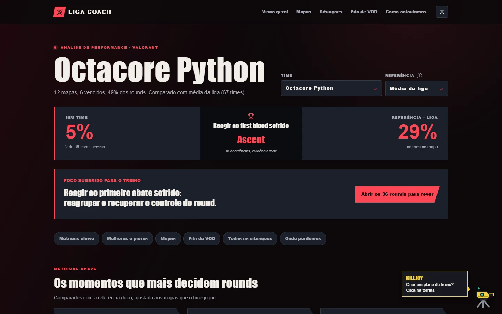

<sub>Hackathon VALORANT · SEMCOMP / USP São Carlos · 19 a 23/10/2026</sub>

</div>

---

**Nesta página:** [A ideia](#a-ideia) · [O que a plataforma faz](#o-que-a-plataforma-faz) · [Telas](#telas) · [Killjoy, a assistente](#killjoy-a-assistente) · [Por que confiar nos números](#por-que-confiar-nos-números) · [Arquitetura](#arquitetura) · [Como rodar](#como-rodar) · [API](#api) · [Publicar](#publicar) · [Equipe](#equipe)

> [!NOTE]
> **Regra do hackathon:** os únicos dados de partida usados são os JSON fornecidos pela organização. Nada de APIs externas, scraping ou integração com a Riot.

## A ideia

Times universitários têm pouco tempo para rever partidas, e estatística solta não ajuda. Dizer "seu retake é 29%" não diz se isso é ruim, se é acaso, nem onde olhar no VOD.

A Liga Coach responde três perguntas, nesta ordem:

| | Pergunta | Como a plataforma responde |
|:-:|---|---|
| **1** | Onde o time perde mais rounds do que a referência? | 12 situações de jogo medidas por time e por mapa, ordenadas pelo que está em jogo |
| **2** | Posso confiar nesse número? | Amostra, intervalo de confiança de 95% e um veredito para cada taxa |
| **3** | Quais rounds eu assisto? | A fila de VOD lista adversário, torneio, data, placar e número do round, com a referência pronta para copiar |

## O que a plataforma faz

| | |
|---|---|
| **Ponto de atenção principal** | Uma frase de coaching com a situação, os números, o nível de evidência e o foco sugerido para o treino |
| **Métricas-chave** | First blood convertido, pós-plant e retake, sempre contra uma referência |
| **Melhores e piores** | Onde o time ganha ou perde mais rounds que a referência, com o saldo em rounds |
| **Onde perdemos** | Cada round perdido em uma categoria só, comparando a fatia das derrotas com a da liga |
| **Análise por mapa** | Ataque e defesa separados, mapa a mapa, com a imagem do mapa |
| **Fila de VOD** | Os rounds exatos em que o time teve a oportunidade e não converteu, com botão de copiar um round ou a fila inteira |
| **Killjoy** | Assistente que monta um plano de treino e responde perguntas só com os dados da análise |
| **Duas referências** | Média da liga ou quartil superior (os 25% melhores times com pelo menos 8 mapas) |
| **Como calculamos** | Página com definições, parâmetros estatísticos e as referências usadas |
| **Tema claro e escuro** | Com layout próprio para celular |

## Telas

<table>
  <tr>
    <td width="50%">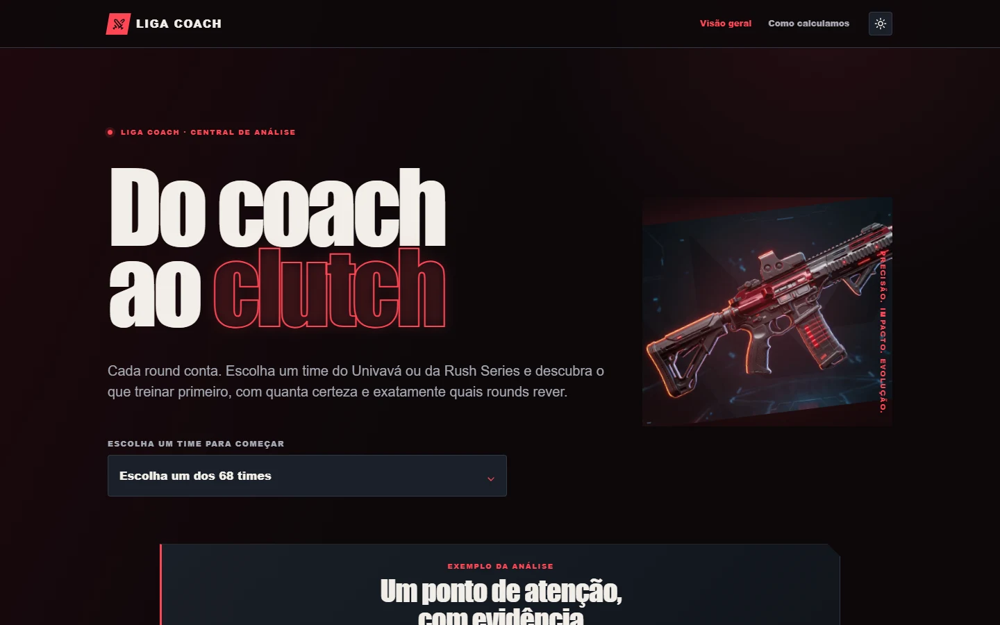<br><b>Início:</b> escolha um dos 68 times do Univavá e da Rush Series</td>
    <td width="50%">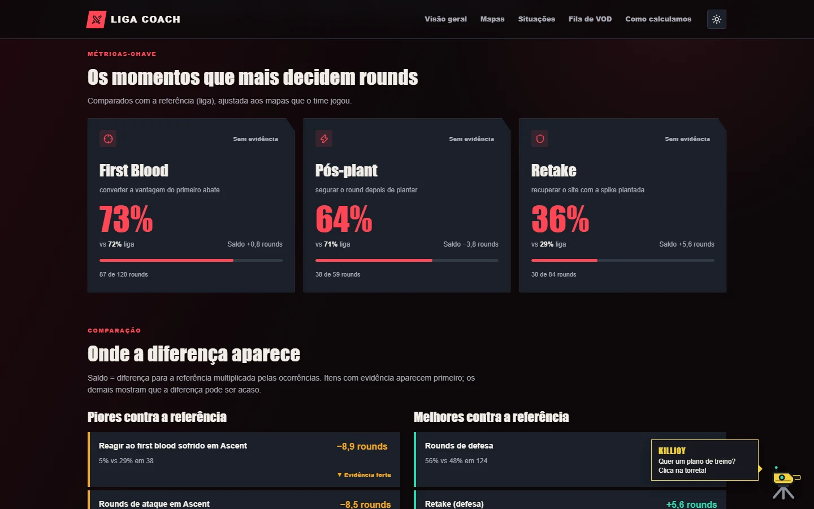<br><b>Métricas-chave:</b> os momentos que mais decidem rounds</td>
  </tr>
  <tr>
    <td>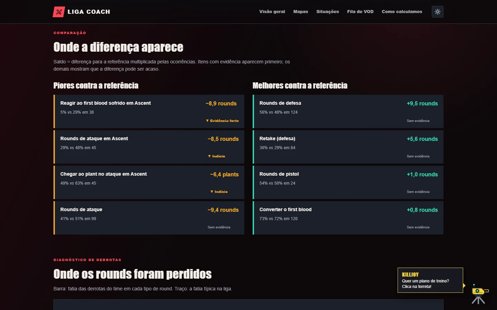<br><b>Melhores e piores:</b> onde a diferença para a referência aparece</td>
    <td>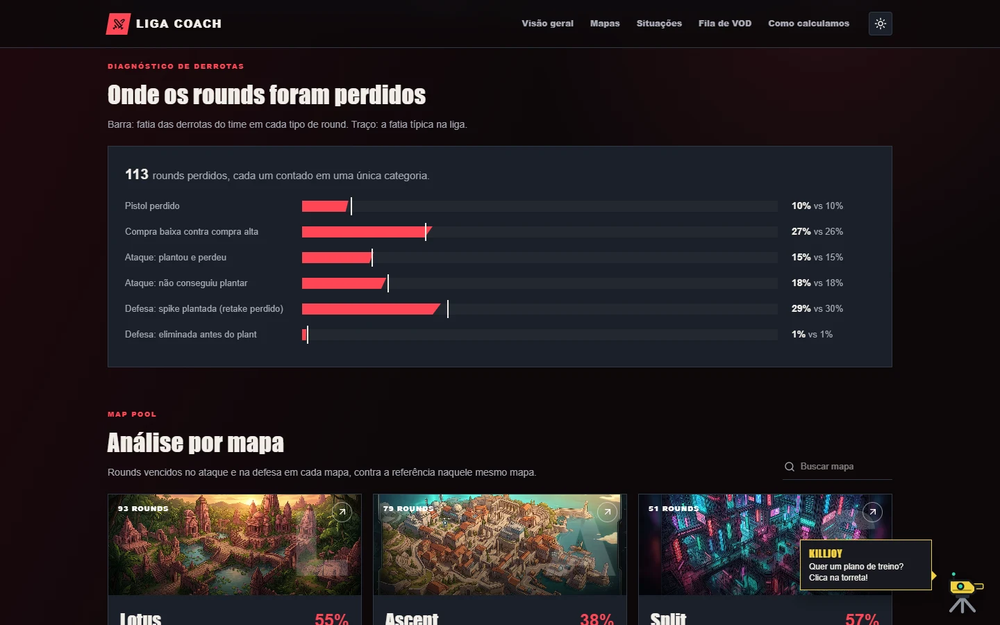<br><b>Onde perdemos:</b> a fatia das derrotas de cada tipo, contra a da liga</td>
  </tr>
  <tr>
    <td>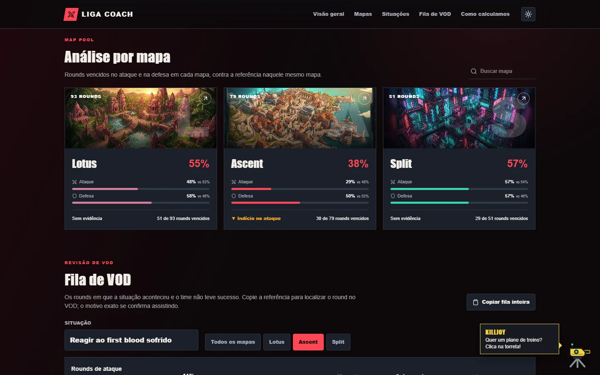<br><b>Mapas:</b> ataque e defesa em cada mapa</td>
    <td>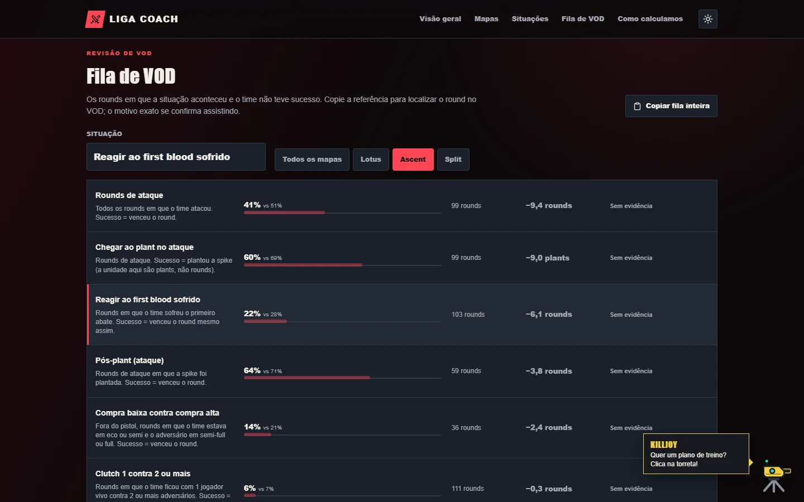<br><b>Fila de VOD:</b> do número ao round exato</td>
  </tr>
  <tr>
    <td>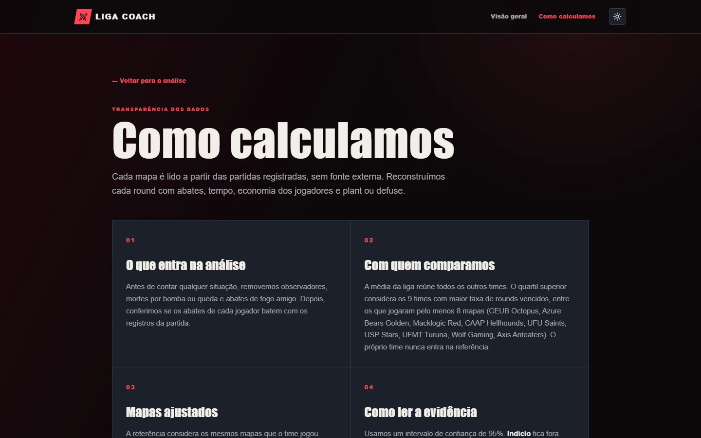<br><b>Como calculamos:</b> o método inteiro, à vista</td>
    <td>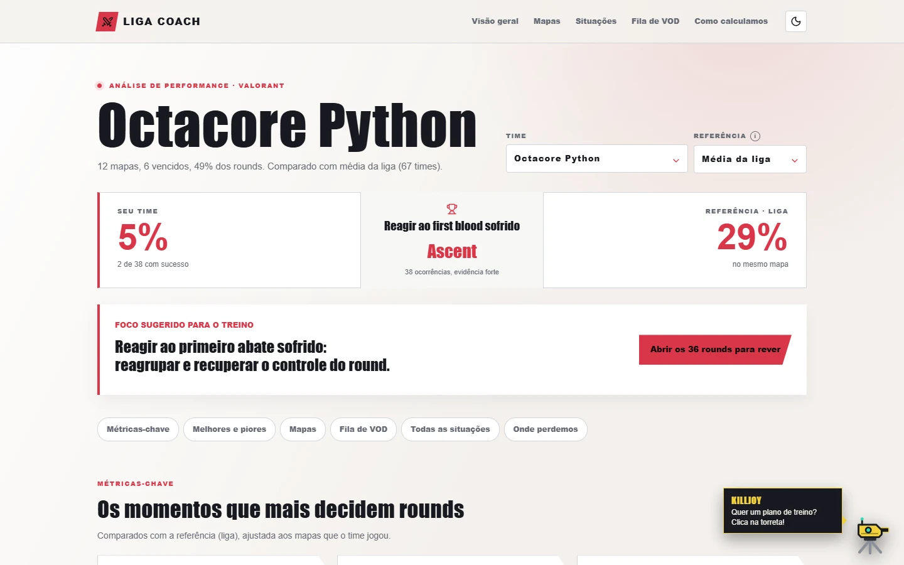<br><b>Tema claro:</b> mesmo contraste das métricas</td>
  </tr>
</table>

## Killjoy, a assistente

<table>
  <tr>
    <td width="62%">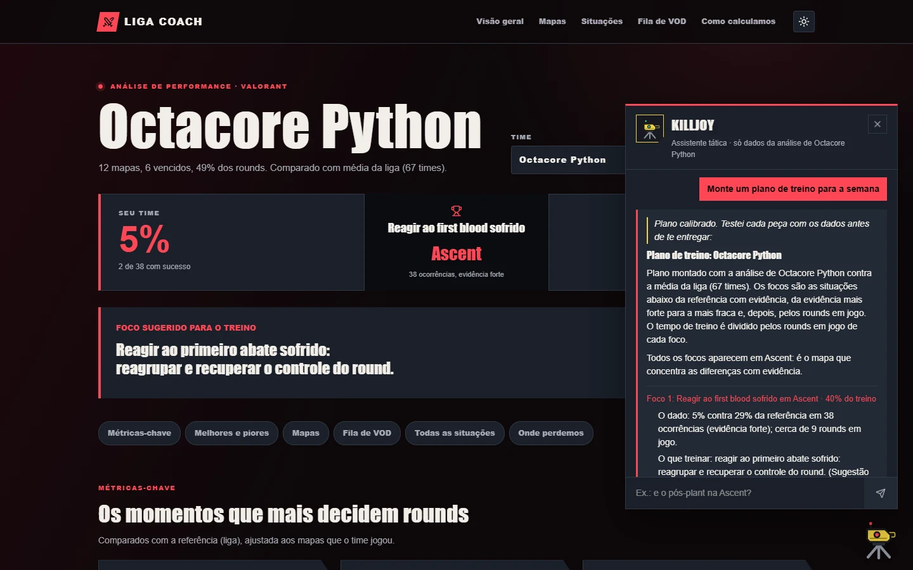</td>
    <td width="38%">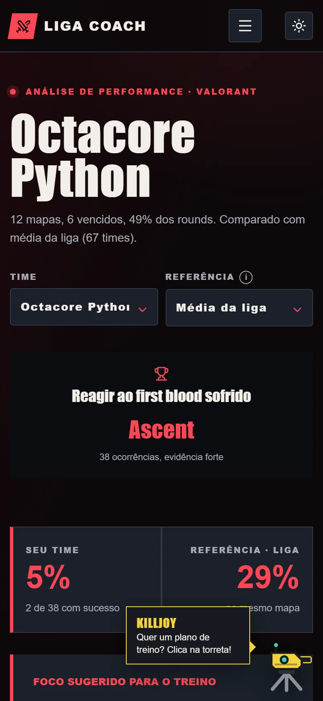</td>
  </tr>
</table>

Clique na torreta no canto da página do time. A Killjoy abre com perguntas prontas para aquele time e também aceita perguntas livres, como "como estamos no pós-plant na Ascent?" ou "estamos tradando bem?".

**Ela não é uma IA generativa e não inventa nada.** Cada resposta é montada com frases-modelo e os números reais da análise, e mostra as fontes. Se a pergunta foge da análise, ela diz que não encontrou.

- **Plano de treino:** até 3 focos com evidência, a fatia do tempo de treino de cada um (proporcional aos rounds em jogo), o mapa onde mais pesa, uma meta para chegar à referência e os primeiros rounds para rever. Também traz o que manter, onde as derrotas passam da liga e o que ficou de fora por falta de evidência.
- **Também responde:** maior problema, pontos fortes, uma situação (no geral ou num mapa), cada mapa, onde perdemos, rounds para rever e como calculamos.
- **Do chat para o VOD:** o botão "Abrir fila de VOD" fecha o balão e leva direto à fila daquela situação.

**Como funciona por dentro (recuperação sem geração):**

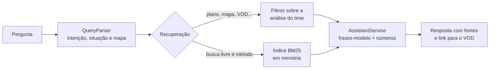

| | |
|---|---|
| **Entendimento** | Regras de intenção e um dicionário de jargão ("pós-plant", "tradando", "contra eco", "4v5"...) |
| **Base de conhecimento** | Documentos gerados da análise de cada time (situações gerais e por mapa, perdas), mais definições, sugestões de foco e metodologia |
| **Desempenho** | Índices dos 68 times × 2 referências montados na subida, em cerca de 1 s. Cada resposta leva cerca de 1 ms |

> [!TIP]
> A Killjoy é uma personagem de fã, inspirada na agente do VALORANT: as falas são originais e a torreta foi desenhada para o projeto, sem arte da Riot.

## Por que confiar nos números

- **Base validada:** depois da limpeza, os abates batem com o placar oficial em **3360 de 3360** linhas. A conferência roda a cada subida do backend.
- **Intervalo de confiança** de Wilson (95%) em toda taxa mostrada, com a amostra sempre visível.
- **Sem conclusões apressadas:** com menos de 20 ocorrências, a plataforma diz "amostra pequena". A cor de destaque só aparece quando a diferença tem evidência.
- **Múltiplas comparações controladas:** a "evidência forte" resiste ao ajuste de Benjamini-Hochberg sobre todos os itens do time.
- **Referência justa:** a referência exclui o próprio time e é ponderada pelos mapas que ele jogou.
- **Números de ouro:** o Java é comparado, número a número, com uma análise independente em Python sobre a base real.

<details>
<summary><b>Método em uma tabela</b></summary>

| Conceito | Como é calculado |
|---|---|
| Situação | Uma regra por classe em `metrics/situations` (ex.: pós-plant = rounds de ataque com spike plantada; sucesso = vencer) |
| Referência | Liga inteira ou quartil superior (times com ≥ 8 mapas), **sem o próprio time**. No geral, é a média das taxas por mapa, ponderada pelos mapas que o time jogou |
| Intervalo | Wilson, 95% |
| Indício | Referência fora do intervalo (teste de score, p < 0,05) |
| Evidência forte | Continua significativa após Benjamini-Hochberg (FDR 10%) sobre todos os itens do time |
| Amostra pequena | Menos de 20 ocorrências |
| Saldo ("em jogo") | (taxa da referência − taxa do time) × ocorrências |

</details>

<details>
<summary><b>As 12 situações medidas</b></summary>

| Situação | O que conta |
|---|---|
| Rounds de ataque | Todos os rounds em que o time atacou |
| Rounds de defesa | Todos os rounds em que o time defendeu |
| Rounds de pistol | Rounds 1 e 13 de cada mapa |
| Converter o first blood | Rounds em que o time fez o primeiro abate; sucesso = vencer |
| Reagir ao first blood sofrido | Rounds em que o time sofreu o primeiro abate; sucesso = vencer mesmo assim |
| Trade do primeiro abatido | Rounds em que o time sofreu o primeiro abate; sucesso = quem fez o abate morreu em até 5 segundos |
| Chegar ao plant no ataque | Rounds de ataque; sucesso = plantar a spike (a unidade é plants) |
| Pós-plant (ataque) | Rounds de ataque com spike plantada; sucesso = vencer |
| Retake (defesa) | Rounds de defesa com spike plantada; sucesso = vencer |
| Anti-eco | Time com compra alta contra adversário em eco, fora do pistol |
| Compra baixa contra compra alta | Time em eco ou semi contra adversário em semi-full ou full, fora do pistol |
| Clutch 1 contra 2 ou mais | Time com 1 jogador vivo contra 2 ou mais adversários |

</details>

<details>
<summary><b>Regras de limpeza da base</b> (no <code>MatchAssembler</code>)</summary>

- O nome do time só existe no nome do arquivo: o lado (Red/Blue) com `roundsWon` igual ao placar A é o time A.
- Observadores (`isObserver=true`, `stats=null`) são removidos.
- Autoabates (bomba, queda) e fogo amigo saem dos eventos de abate. Com isso, os abates batem 100% com `stats.kills`.
- O lado atacante de cada round vem de `winningTeam` + `winningTeamRole`.
- `roundNum` é 0-based; a fila de VOD mostra 1-based.

</details>

## Arquitetura

Monólito modular, sem banco: o backend lê os JSON uma vez na subida, guarda tudo em memória e entrega a análise por uma API REST.

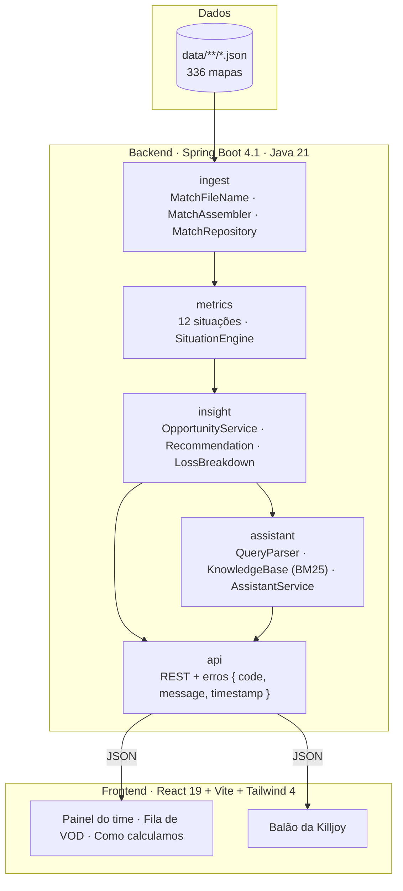

| Camada | Tecnologia |
|---|---|
| Backend | Spring Boot 4.1 · Java 21 · API REST (sem banco: tudo em memória) |
| Frontend | React 19 · Vite · Tailwind 4 · lucide-react |
| Análise da base | Scripts Python em `tools/analise/` |
| Qualidade | 83 testes JUnit · GitHub Actions (backend e frontend) |
| Entrega | Site estático, jar único ou Docker |

<details>
<summary><b>Estrutura do repositório</b></summary>

```
.
├── backend/              API REST, motor de métricas e assistente
│   └── src/main/java/br/pauta/
│       ├── ingest/       leitura e limpeza dos JSON
│       ├── metrics/      as 12 situações e o SituationEngine
│       ├── insight/      referências, estatística, recomendações e perdas
│       ├── assistant/    Killjoy: entendimento da pergunta, índice BM25 e respostas
│       └── api/          controllers REST
├── frontend/             Interface React
├── data/                 JSON da organização (336 mapas)
├── docs/                 Pitch, tarefas e imagens (docs/img)
├── tools/analise/        Scripts Python dos "números de ouro"
├── scripts/              Preparar dados e gerar o snapshot estático
└── Dockerfile            Imagem única (front + API + base)
```

</details>

## Como rodar

**Pré-requisitos:** JDK 21 (o Maven vem pelo `mvnw`) e Node 20+. Python 3 é opcional (só para `tools/analise`).

A base de partidas já vem no repositório, em `data/`: não há download nem preparo de dados.

```bash
git clone https://github.com/treles/onetap.git
cd onetap/backend && ./mvnw spring-boot:run      # terminal 1: API em http://localhost:8080
cd onetap/frontend && npm install && npm run dev  # terminal 2: tela em http://localhost:5173
```

> [!TIP]
> No Windows (PowerShell), use `.\mvnw.cmd spring-boot:run` no lugar de `./mvnw spring-boot:run`.

O log do backend deve mostrar:

```
336 partidas, 6618 rounds, 0 arquivos rejeitados ... reconciliacao de kills 3360/3360
Assistente: índices de 68 times prontos em ... ms
```

- **Links diretos:** por exemplo `#time=octacore_python&ref=top25`.
- **Backend em outra porta:** `PAUTA_API=http://localhost:8092 npm run dev`.
- **Outra pasta de dados:** defina `PAUTA_DATA_DIR`. Para atualizar a base a partir dos zips do edital, use `scripts/preparar-dados.ps1`.

### Testes

```bash
cd backend && ./mvnw test
```

São 83 testes. O `GoldenNumbersTest` compara o Java com os valores calculados pelos scripts Python sobre a base real (referências da liga, números de times, identidades de soma, referência por mapa, Benjamini-Hochberg). Os testes da Killjoy cobrem o entendimento das perguntas e as respostas com a base real. Como a base está no repositório, tudo roda em qualquer clone e no CI.

## API

| Rota | Retorno |
|---|---|
| `GET /api/health/data` | Integridade da base (arquivos, rounds, abates, reconciliação) |
| `GET /api/teams` | Times com nome legível, mapas e win rate |
| `GET /api/teams/{time}/report?benchmark=league\|top25` | Visão geral, recomendação, pontos de atenção, pontos fortes e todas as situações |
| `GET /api/teams/{time}/situations/{id}?benchmark=` | A situação no geral e por mapa |
| `GET /api/teams/{time}/situations/{id}/vod?map=` | Fila de VOD (rounds sem sucesso) |
| `GET /api/teams/{time}/losses` | Onde os rounds foram perdidos (categorias excludentes) contra a liga |
| `GET /api/teams/{time}/assistant/suggestions?benchmark=` | Perguntas sugeridas para o time |
| `POST /api/teams/{time}/assistant` | Resposta da Killjoy. Corpo: `{ "question": "...", "benchmark": "league" }` |
| `GET /api/methodology` | Definições, referências da liga e parâmetros estatísticos |

Erros seguem `{ "code", "message", "timestamp" }`: `TEAM_NOT_FOUND`, `SITUATION_NOT_FOUND`, `INVALID_PARAMETER` e `INVALID_BODY`.

## Como adicionar uma situação

1. Crie uma classe em `backend/src/main/java/br/pauta/metrics/situations/` que implemente `Situation`, anotada com `@Component`. Use `PostPlant.java` como modelo.
2. Escreva em `definition()` exatamente o que é contado e o que é "sucesso": o texto aparece para o usuário.
3. Adicione os números de ouro no `GoldenNumbersTest`.
4. O `SituationEngine` encontra a classe sozinho, e ela aparece no painel, na fila de VOD e nas respostas da Killjoy. Para a Killjoy reconhecer o jargão da nova situação, acrescente as expressões em `assistant/Vocabulary.java`.

## Publicar

### Opção A: site estático (sem servidor)

O snapshot contém só agregados e referências de rounds, não a base bruta. A Killjoy responde as perguntas sugeridas (as respostas vão pré-calculadas no snapshot); a pergunta livre precisa do servidor.

```bash
cd backend && ./mvnw spring-boot:run          # terminal 1
node scripts/gerar-snapshot.mjs                # terminal 2: gera frontend/public/snapshot
cd frontend && npm run build:static            # gera frontend/dist
```

Publique a pasta `frontend/dist` em qualquer hospedagem estática, como o Netlify Drop (app.netlify.com/drop).

### Opção B: jar ou Docker (com servidor)

```bash
cd frontend && npm run build:jar && cd ../backend && ./mvnw package && java -jar target/pauta.jar
```

Ou `docker build -t pauta . && docker run -p 8080:8080 pauta` (a imagem já inclui a base).

## Próximos passos

- **Dados:** trocar a memória por um banco e uma ingestão contínua, para a análise atualizar a cada partida e mostrar a evolução do time ao longo do campeonato.
- **Produto:** análise por jogador, agente e arma (o JSON já traz dano, localização, economia e habilidades), VOD ligado ao minuto do round e um comparador com o próximo adversário.
- **Killjoy:** relatório semanal do treinador e acompanhamento do plano de treino, partida a partida.

## Equipe

| | |
|---|---|
| **Maria Fernanda** | [@marifermenezes](https://github.com/marifermenezes) |
| **Thales** | [@treles](https://github.com/treles) |
| **Kelly** | [@kellykky](https://github.com/kellykky) |

O visual parte do protótipo do time, aplicado sobre o app Vite + React e alimentado pela API real: nenhum número é fixo no código. As imagens dos mapas ficam em `frontend/src/assets/maps/` (veja o `LEIA-ME.md` dessa pasta).

---

<sub>Projeto independente, feito só com os arquivos fornecidos pela organização do Hackathon VALORANT. Não é afiliado à Riot Games. VALORANT e Killjoy são marcas da Riot Games, Inc.</sub>
